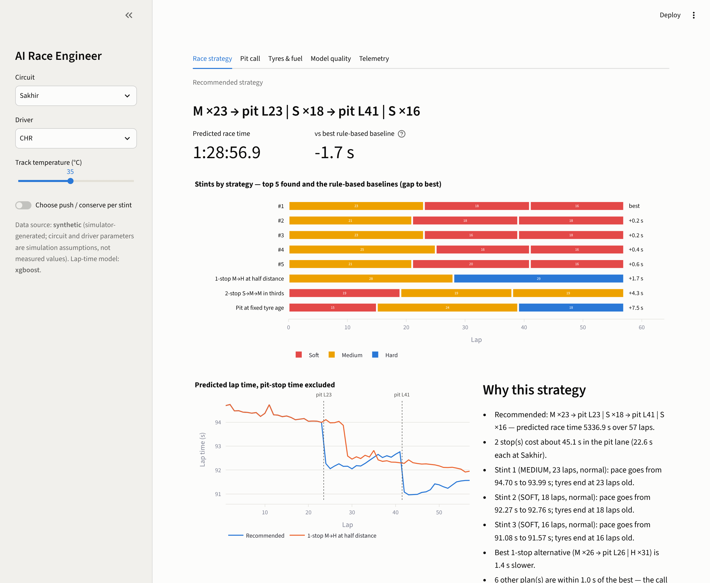

# AI Race Engineer

Telemetry and race context → lap-time, tyre and fuel models → race simulation →
strategy recommendations with explanations.



## Quick start

```bash
python -m venv .venv && . .venv/bin/activate
pip install -e ".[dev]"
python -m race_engineer.cli pipeline          # data -> models -> strategy evaluation -> artifacts/
streamlit run race_engineer/dashboard/app.py  # engineer dashboard
python -m pytest                              # 37 tests, about a minute
```

```bash
python -m race_engineer.cli strategy --circuit Sakhir --modes
python -m race_engineer.cli call --circuit Monza --lap 28 --compound MEDIUM --tyre-age 27
```

## What the data is

Everything is currently trained and evaluated on **synthetic races** produced by
the reference simulator (`race_engineer/sim/physics.py`). Circuit, compound and
driver parameters in `config.py` are simulation assumptions, not measurements.
Results therefore show that the pipeline can recover a known ground truth and
turn it into good decisions; they say nothing yet about real F1 races.

`data/fastf1_loader.py` maps FastF1 sessions into the same lap schema (fuel is
estimated and flagged, drive mode is unknown). Its mapping is unit-tested on a
FastF1-shaped table, but it has not been run against the live FastF1 service.

## Layout

| Module | Role |
|---|---|
| `data/` | synthetic generator, synthetic telemetry, FastF1 loader, schema validation |
| `features/` | time-weighted telemetry aggregates; pre-lap vs post-lap feature split (leakage guard) |
| `models/` | lap time (baselines, linear, random forest, gradient boosting, XGBoost), tyre degradation, fuel, registry |
| `sim/` | reference physics and the vectorised race simulator with rule constraints |
| `strategy/` | plan enumeration/optimizer, pit-now-vs-stay-out call, rule-based baselines, ground-truth evaluation, explanations |
| `rl/` | Gymnasium environment (tested against the simulator); PPO script needs `stable-baselines3` |
| `dashboard/` | Streamlit app |

## How decisions are evaluated

Sessions of the latest season are held out whole. The lap-time model is chosen
by grouped cross-validation on training sessions only, then reported on the
held-out season. Strategies picked with the learned models are re-scored on
the reference physics, never on the model that chose them:

* **regret** – time lost versus the true optimal strategy
* **gain** – time saved versus three rule-based baselines

## Known limits

* Fuel burn-off and track evolution are not separated; the degradation model
  absorbs both in one race-progression term.
* Drive mode is fixed per stint in the optimizer; no safety cars, traffic,
  rivals or weather changes.
* Tree models do not extrapolate, so circuits or tyre ages outside the training
  data are rejected or constrained rather than guessed.
* Reinforcement learning is an environment plus a training script; no agent
  has been trained.
